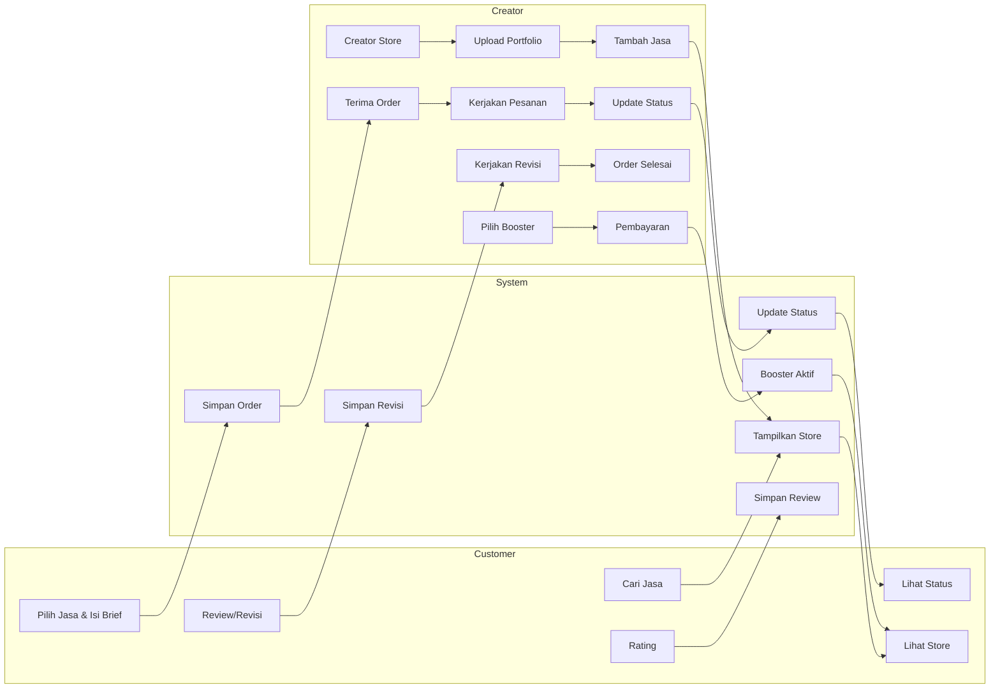

# ARCHITECTURE.md

## System Architecture — Platform Jasa Kreatif Digital

### 1. Architectural Goal

Arsitektur sistem dirancang untuk mendukung proses:
- Penyedia jasa (**Creator**) membuka & mengelola lapak jasa kreatif (Creative Shop).
- Pelanggan (**Customer**) mencari, memesan, dan memberi ulasan jasa.
- **System** menjadi penghubung yang mengatur data, status pesanan, dan monetisasi (Booster).

### 2. Actors

| Actor | Peran |
|---|---|
| **Customer** | Mencari jasa, melihat store, memesan (isi brief), memantau status, memberi rating |
| **System** | Menyimpan data, menampilkan store, mengatur order, mengaktifkan booster |
| **Creator** | Membuka store, upload portofolio, mengelola jasa & pesanan |

### 3. High-Level Flow



### 4. Modules / Subsystems

1. **Auth & User Management**
   Registrasi/login, role (`customer`, `creator`, `admin`), profil dasar.

2. **Creative Shop (Creator Store)**
   - Profil creator
   - Portofolio (galeri karya)
   - Kategori jasa (Desain Grafis, Ilustrasi, Fotografi, Videografi, Video Editing, UI/UX, Motion Graphic, 3D Design, Audio & Musik, Copywriting, Social Media Creative)
   - Paket & harga jasa (nama paket, harga, estimasi pengerjaan, jumlah revisi)
   - Status ketersediaan (open/closed for order)

3. **Order Management**
   - Form brief terstruktur (kebutuhan, referensi, format, deadline, catatan)
   - Status pesanan: `pending → diterima → dikerjakan → revisi → selesai`
   - Riwayat revisi

4. **Rating & Review**
   - Rating bintang + komentar setelah order selesai
   - Ditampilkan di halaman store creator

5. **Booster (SaaS/Monetization)**
   - Creator memilih paket booster (durasi/jenis eksposur)
   - Pembayaran (bisa simulasi/sandbox untuk MVP)
   - Sistem menaikkan prioritas tampilan store/jasa yang di-boost

### 5. Suggested Data Model (Simplified)

- **User** (id, name, email, password, role)
- **CreatorProfile** (id, user_id, bio, avatar, availability_status)
- **Portfolio** (id, creator_id, image_url, title, description)
- **ServiceCategory** (id, name)
- **Service** (id, creator_id, category_id, title, description)
- **ServicePackage** (id, service_id, name, price, estimated_days, revision_count)
- **Order** (id, customer_id, service_package_id, brief_text, reference_files, deadline, status)
- **Revision** (id, order_id, note, file_url, created_at)
- **Review** (id, order_id, rating, comment)
- **BoosterPlan** (id, name, duration_days, price)
- **BoosterPurchase** (id, creator_id, booster_plan_id, service_id, start_date, end_date, payment_status)

### 6. API Layer (Contoh Endpoint Utama)

```
POST   /auth/register
POST   /auth/login

GET    /creators/:id/store
POST   /creators/:id/portfolio
POST   /creators/:id/services
PATCH  /creators/:id/availability

GET    /services?category=&search=
POST   /orders
GET    /orders/:id
PATCH  /orders/:id/status
POST   /orders/:id/revision

POST   /orders/:id/review

POST   /booster/purchase
GET    /booster/active
```

### 7. Non-Functional Notes

- **Scalability:** struktur modular per fitur agar mudah dikembangkan lebih lanjut (mis. payment gateway asli, chat real-time).
- **Security:** validasi role di setiap endpoint (creator vs customer), sanitasi upload file.
- **Extensibility:** kategori jasa & paket booster dibuat sebagai data dinamis (bukan hardcode), agar mudah ditambah tanpa ubah kode.

### 8. Reference

Diagram alur (Customer–System–Creator) disusun berdasarkan rancangan sistem pada proposal "Ide Perancangan Sistem Web Sebagai Platform Jasa Kreatif Digital Berbasis Marketplace dan SaaS".
